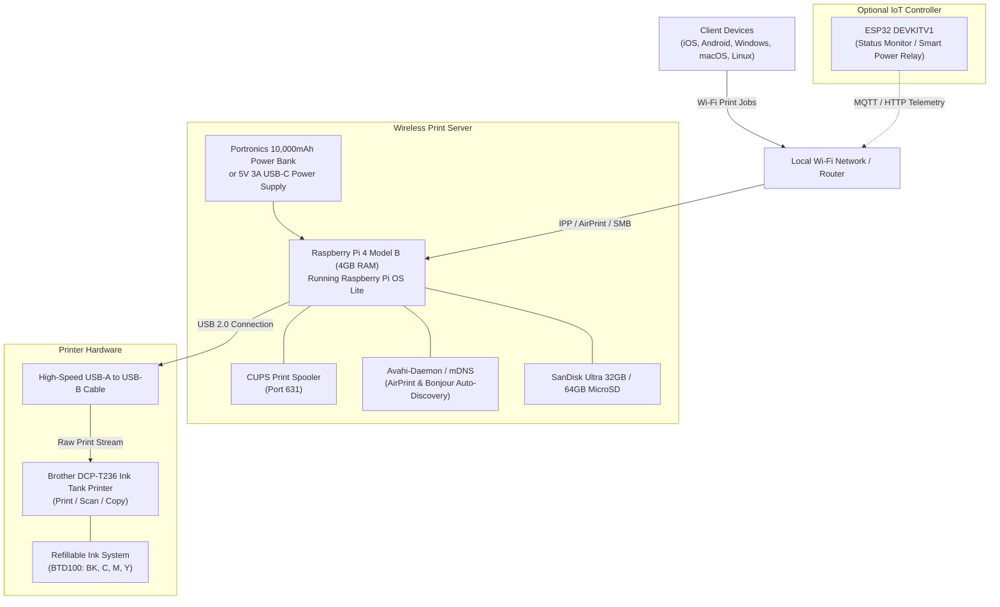

# Brother DCP-T236 Wireless Print Server & IoT Project

A modular hardware inventory, documentation, and configuration suite for turning the **Brother DCP-T236 All-in-One Ink Tank Printer** into a networked wireless print server (with AirPrint & Mopria support) using a **Raspberry Pi 4 Model B (4GB)** and an optional **ESP32 IoT controller**.

---

## 🏗️ System Architecture



---

## 📁 Repository Structure

```
Printer/
├── docs/                                    # Technical documentation & guides
│   ├── HARDWARE_INVENTORY.md               # Detailed component catalog & photo links
│   ├── PRINT_SERVER_SETUP_GUIDE.md         # Step-by-step Raspberry Pi CUPS & AirPrint setup
│   ├── PRINTER_SPECS_AND_MAINTENANCE.md    # DCP-T236 specs, cleaning steps, ink details
│   ├── ESP32_IOT_INTEGRATION.md            # ESP32 smart power relay & status monitor design
│   └── GLOBAL_PRINTING_AND_ESP32_ANALYSIS.md # Deep technical breakdown of ESP32 vs Pi & Global Tunneling
├── images/                                  # Organized & semantically named hardware photos
│   ├── 01_brother_printer/                 # Printer overview, tanks, panel, labels, box
│   ├── 02_raspberry_pi/                    # Raspberry Pi 4B board, MicroSD slot, box
│   ├── 03_esp32/                           # ESP32 DEVKITV1 board photos
│   ├── 04_cables_adapters/                 # USB-B printer cable, OTG adapters, micro-USB
│   └── 05_power_storage/                   # Portronics power bank, SanDisk MicroSD cards
├── raw_camera_photos/                       # Original untouched camera files (archive)
│   └── IMG_202610*.jpg                     # 22 original camera captures preserved
├── scripts/                                 # Automation & diagnostic scripts
│   ├── setup_cups_print_server.sh          # One-click CUPS + AirPrint installer for Pi
│   ├── test_usb_printer.py                 # Python USB printer detection & diagnostic script
│   └── printer-web.service                 # Systemd auto-start service for Raspberry Pi
└── web_app/                                 # GlassyPrint Hub Web Application
    ├── app.py                              # Flask backend with CUPS & simulation support
    ├── requirements.txt                    # Python dependencies (Flask, Pillow, pypdfium2)
    ├── start_web_server.bat                # Windows 1-click launcher
    ├── start_web_server.sh                 # Linux / Raspberry Pi launcher
    ├── templates/index.html                # Modern frosted-glass dark UI
    ├── static/css/style.css                # Glassmorphic CSS with ambient glow & responsive layout
    ├── static/js/main.js                   # Drag-drop, real-time polling & print dispatch
    └── uploads/                            # Stored print jobs & PDF thumbnails
```

---

## 🧰 Hardware Inventory Summary

| Category | Component | Key Specifications | Photographic Reference |
|---|---|---|---|
| **Printer** | Brother DCP-T236 | Ink Tank All-in-One (Print, Scan, Copy), 16 ipm mono / 9 ipm colour | [images/01_brother_printer/](file:///d:/Desktop/Printer/images/01_brother_printer/) |
| **Compute** | Raspberry Pi 4 Model B | Broadcom BCM2711, 4GB LPDDR4, Dual-Band Wi-Fi, Gigabit LAN | [images/02_raspberry_pi/](file:///d:/Desktop/Printer/images/02_raspberry_pi/) |
| **Microcontroller** | ESP32 DEVKITV1 | 30-pin ESP-WROOM-32, 2.4 GHz Wi-Fi + Bluetooth LE | [images/03_esp32/](file:///d:/Desktop/Printer/images/03_esp32/) |
| **Data Cable** | USB 2.0 Type-A to Type-B | White high-speed shielded printer cable | [images/04_cables_adapters/](file:///d:/Desktop/Printer/images/04_cables_adapters/) |
| **Adapters** | USB-C OTG & Micro-USB OTG | Red Type-C OTG + Official Raspberry Pi Micro-USB OTG | [images/04_cables_adapters/](file:///d:/Desktop/Printer/images/04_cables_adapters/) |
| **Power** | Portronics 10,000 mAh | Portable power bank with integrated Type-C cable loop | [images/05_power_storage/](file:///d:/Desktop/Printer/images/05_power_storage/) |
| **Storage** | SanDisk Ultra MicroSD | 32GB (inserted in Pi) + 64GB (A1, Class 10 MicroSDXC) | [images/05_power_storage/](file:///d:/Desktop/Printer/images/05_power_storage/) |

---

## 🚀 Quick Navigation

- **Hardware Specs & Serial Numbers**: [docs/HARDWARE_INVENTORY.md](file:///d:/Desktop/Printer/docs/HARDWARE_INVENTORY.md)
- **Turn DCP-T236 into a Wireless Print Server**: [docs/PRINT_SERVER_SETUP_GUIDE.md](file:///d:/Desktop/Printer/docs/PRINT_SERVER_SETUP_GUIDE.md)
- **Printhead Cleaning & Maintenance Procedures**: [docs/PRINTER_SPECS_AND_MAINTENANCE.md](file:///d:/Desktop/Printer/docs/PRINTER_SPECS_AND_MAINTENANCE.md)
- **ESP32 IoT Controller Integration**: [docs/ESP32_IOT_INTEGRATION.md](file:///d:/Desktop/Printer/docs/ESP32_IOT_INTEGRATION.md)
- **Automated CUPS Installer**: [scripts/setup_cups_print_server.sh](file:///d:/Desktop/Printer/scripts/setup_cups_print_server.sh)

