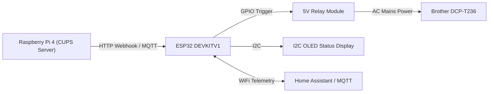

# ESP32 IoT Integration Guide

The workspace includes an **ESP32 DEVKITV1** board ([images/03_esp32/01_esp32_devkit_v1_top.jpg](file:///d:/Desktop/Printer/images/03_esp32/01_esp32_devkit_v1_top.jpg)). While the **Raspberry Pi 4** acts as the full print spooler (running CUPS & AirPrint), the ESP32 can be integrated as an ultra-low-power IoT companion controller.

---

## 💡 Practical Use Cases for ESP32 in this Setup

---

## Use Case 1: Smart Auto-Power Relay (Energy Saver)

### The Problem:
Inkjet printers left powered on continuously consume idle power (~1.5W - 3W), whereas power cycling them properly via mains relay when print jobs arrive can save energy and automate workshop workflows.

### How it works:
1. When a client sends a print job to CUPS on the Raspberry Pi 4, a CUPS backend hook or script triggers an HTTP request to the ESP32.
2. The ESP32 energizes a 5V relay module connected to the Brother DCP-T236 mains input.
3. Once printing finishes and CUPS queue is empty for 15 minutes, the ESP32 switches the relay off.

---

## Use Case 2: Desk Status Monitor (OLED / LED Indicator)

### The Problem:
The Brother DCP-T236 only has basic LEDs (Power, Ink, Paper). It does not have an LCD screen showing printer status, IP address, or queue size.

### How it works:
1. Attach an inexpensive 0.96" I2C OLED display (SSD1306) to the ESP32 (SDA -> D21, SCL -> D22).
2. The ESP32 queries the Raspberry Pi CUPS API or Home Assistant via Wi-Fi every 10 seconds.
3. The OLED displays:
   - Current Print Queue: `0 jobs` or `Printing page 2/5...`
   - Print Server IP: `192.168.1.50`
   - Wi-Fi Signal Strength (RSSI)

---

## Use Case 3: Physical Quick-Print / Scan Remote

- Connect a physical push button to ESP32 `GPIO 14` (with internal pull-up).
- Pressing the button sends an MQTT command to the Raspberry Pi to:
  - Print a daily briefing / calendar schedule.
  - Trigger a scan operation using `sane-utils` (`scanimage`) and upload the PDF directly to a network folder or Google Drive!

---

## 🔌 Pinout Reference for ESP32 DEVKITV1 (30-pin)

| Pin | Function / Recommended Use |
|---|---|
| **VIN** | 5V Input (from USB or external 5V power supply) |
| **GND** | Common Ground |
| **3V3** | 3.3V Output for sensors / OLED |
| **D21** | I2C SDA (for OLED display / external sensors) |
| **D22** | I2C SCL (for OLED display / external sensors) |
| **D18 / D19** | SPI SCK / MISO |
| **D23** | SPI MOSI |
| **D2** | On-board blue LED |
| **D4 / D5** | GPIO for Relay module trigger |

