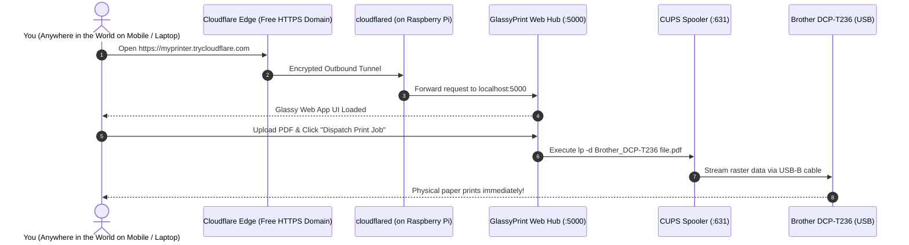

# Global Remote Printing & ESP32 Technical Feasibility Analysis

This document provides a technical evaluation of your two project goals:
1. **Goal 1**: Printing from anywhere globally via a modern glassy web application.
2. **Goal 2**: Replacing the Raspberry Pi 4 with an **ESP32** connected directly to the Brother DCP-T236.

---

## ⚠️ Part 1: Can the ESP32 Directly Replace the Raspberry Pi 4?

### The Short Answer:
**No, an ESP32 cannot directly drive the Brother DCP-T236 Ink Tank printer over USB.**

### Deep Technical Reasons:

#### 1. Hardware USB Host Capability
* The board in your inventory ([images/03_esp32/01_esp32_devkit_v1_top.jpg](file:///d:/Desktop/Printer/images/03_esp32/01_esp32_devkit_v1_top.jpg)) is an **ESP32 DEVKITV1 (ESP-WROOM-32)**.
* Its Micro-USB port is wired to a CP2102/CH340 USB-to-UART chip configured exclusively in **USB Device / Slave mode**. It has **zero hardware USB Host controllers**. It physically cannot initiate or manage USB communication with another USB device (like a printer).
* *(Even newer chips like ESP32-S2 / ESP32-S3 that have native USB OTG only support USB 1.1 Full-Speed (12 Mbps) and basic HID/CDC classes, not high-speed bulk printer transfers).*

#### 2. The Nature of Inkjet Page Printing vs. Receipt Printers
* **Receipt / Thermal Printers** (such as grocery store POS printers) accept simple plain-text ASCII streams (`ESC/POS` commands) and print line-by-line using tiny microcontroller memory.
* **Inkjet Page Printers (like Brother DCP-T236)** require a full **Raster Image Processor (RIP)**.
  - When you print a page from an iPhone, PDF, or Word document, the computer must convert the document into a high-resolution 2D dot matrix (raster bitmap) for Cyan, Magenta, Yellow, and Black print heads.
  - At **600 DPI**, a single A4 page requires **~35 Megabytes of uncompressed bitmap memory**.
  - At **1200 DPI**, it requires **over 140 Megabytes**.
  - The ESP32 only has **320 KB - 520 KB of internal SRAM**, which is thousands of times too small to hold or rasterize a single page.

#### 3. Driver & Protocol Stack
* The Brother DCP-T236 requires proprietary Brother raster command filters (`brlaser` / `rastertobrother`) and Ghostscript. These run exclusively within Linux / Unix print spoolers like **CUPS**.
* There is no existing firmware, C++ library, or driver stack for ESP32 that can translate a PDF into Brother inkjet raster commands.

---

## 🏆 The Ideal Solutions for Your Vision

### Solution A: The Ultra-Compact Hardware Alternative (Raspberry Pi Zero 2 W)
If your motivation for wanting an ESP32 is **size, power consumption, or cost**:
* Use a **Raspberry Pi Zero 2 W** ($15):
  * **Dimensions**: 65 mm × 30 mm (almost identical in size to the ESP32 board!).
  * **Power Consumption**: Only ~0.5 Watts (can run continuously 24/7).
  * **Software**: Runs full 64-bit Raspberry Pi OS, CUPS, Brother drivers, and our Glassy Web App!
  * You can tuck a Pi Zero 2 W directly behind or inside the Brother printer's cable compartment.

### Solution B: How the ESP32 CAN Be Used as a Powerful Companion
Keep the Raspberry Pi (or Pi Zero 2 W) doing the heavy print rasterization, and use the **ESP32 DEVKITV1** for:
1. **Smart Auto-Power Relay**: Turns the Brother printer's AC mains power ON only when a print job arrives from the website, and powers it OFF after 10 minutes of inactivity.
2. **Desk OLED Status Display**: Shows live printer queue, print progress, and IP address.
3. **Physical Scan / Print Button**: Triggers a pre-set scan to Google Drive or prints a daily schedule.

---

## 🌐 Part 2: Printing from Anywhere in the World (Global Access)

You do **not** need a static public IP or dangerous port forwarding on your router. You can securely expose the **GlassyPrint Hub** to the world using **Cloudflare Tunnels (Zero Trust)** for free:



### Step-by-Step Global Setup on the Raspberry Pi:

1. **Install Cloudflare Tunnel Client**:
   ```bash
   curl -L --output cloudflared.deb https://github.com/cloudflare/cloudflared/releases/latest/download/cloudflared-linux-arm64.deb
   sudo dpkg -i cloudflared.deb
   ```

2. **Launch a Quick Tunnel**:
   ```bash
   cloudflared tunnel --url http://localhost:5000
   ```
   * Cloudflare will output a public HTTPS address like:
     `https://random-words.trycloudflare.com`
   * Open this URL on your phone using 4G/5G cellular data from anywhere in the world, and you can upload files and print directly!

3. **Make it Permanent with a Custom Domain (Optional)**:
   * If you own a domain (e.g. `yourname.com`), you can bind it permanently to `print.yourname.com` using Cloudflare Zero Trust with Google/Email OTP authentication for maximum security.

